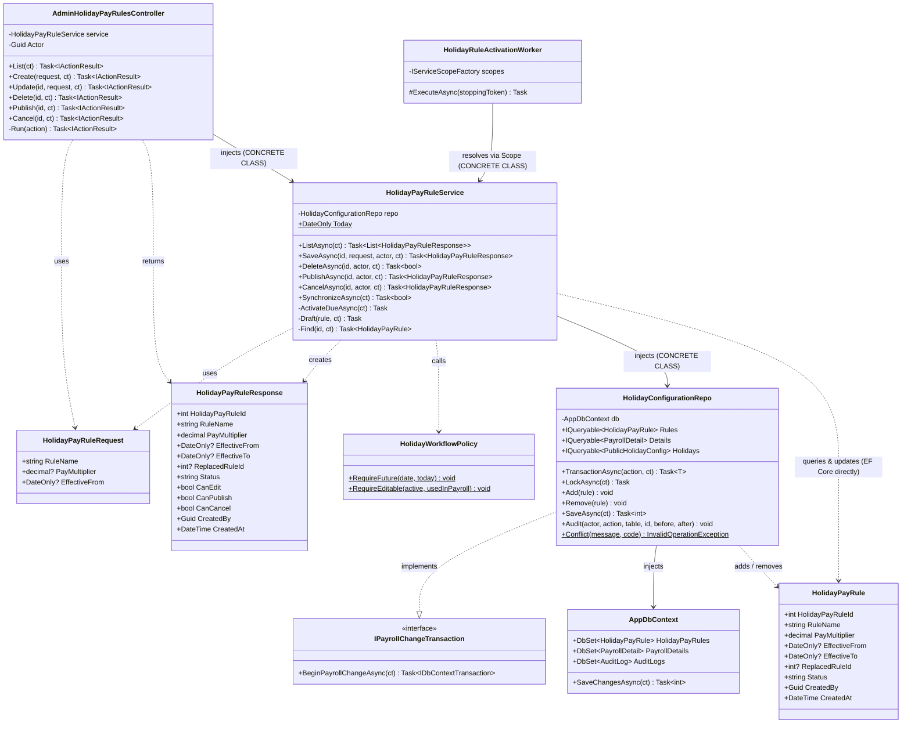

# BÁO CÁO KIỂM TRA KIẾN TRÚC CODE: 4 CHỨC NĂNG HOLIDAY PAY RULE — WORKSHIFT

> **Ngày thực hiện:** 03/11/2026  
> **Dự án:** WorkShift ASP.NET Core Backend (`WorkShiftServer`)  
> **Kiến trúc đối chiếu:** 3-Layer Architecture (`WorkShiftServer.API` → `WorkShiftManagement.BLL` → `WorkShiftManagement.DAL`)  
> **Phạm vi kiểm tra:** 4 chức năng Holiday Pay Rule:
> 1. View Holiday Pay Rule History
> 2. Create Holiday Pay Rule
> 3. Update Holiday Pay Rule
> 4. Delete Holiday Pay Rule

---

## A. TỔNG QUAN KIẾN TRÚC HIỆN TẠI VÀ LUỒNG GỌI THỰC TẾ

### 1. Hiện trạng cấu trúc mã nguồn

| Thành phần | Đường dẫn thực tế hiện tại | Tình trạng |
| :--- | :--- | :--- |
| **API Controller** | `WorkShiftServer.API/Controllers/Admin/AdminHolidayPayRulesController.cs` | Tồn tại. Inject trực tiếp Service cụ thể (`HolidayPayRuleService`), không inject Interface. |
| **Service Interface** | *Không tồn tại* (`IHolidayPayRuleService.cs` bị thiếu) | **VI PHẠM:** Không có interface ở tầng BLL. |
| **Service Implementation** | `WorkShiftManagement.BLL/Services/Admin/HolidayPayRuleService.cs` | Tồn tại. Inject trực tiếp Repository cụ thể (`HolidayConfigurationRepo`). Tự chứa luôn DTO `HolidayPayRuleRequest` và `HolidayPayRuleResponse` trong cùng file service. |
| **Repository Interface** | *Không tồn tại* (`IHolidayPayRuleRepo.cs` bị thiếu) | **VI PHẠM:** Không có interface riêng cho HolidayPayRule ở tầng DAL. |
| **Repository Implementation** | `WorkShiftManagement.DAL/Repositories/Admin/HolidayConfigurationRepo.cs` | Tồn tại dưới dạng repo dùng chung (Shared Persistence Boundary). Chỉ implement `IPayrollChangeTransaction` (chỉ có method `BeginPayrollChangeAsync`). Phơi bày trực tiếp `IQueryable<T>` (`Rules`, `Details`, `Holidays`) ra tầng BLL. |
| **DTOs** | Định nghĩa nội tuyến trong `HolidayPayRuleService.cs` (dòng 9-19) | **VI PHẠM CONVENTION:** Không được đặt trong thư mục `WorkShiftManagement.BLL/DTOs/Admin/HolidayPayRule/`. |
| **Domain Entity** | `WorkShiftManagement.DAL/Entities/HolidayPayRule.cs` | Tồn tại đầy đủ quan hệ với `PayrollDetail`, `User`, `InverseReplacedRule`. |
| **Database Context** | `WorkShiftManagement.DAL/Data/AppDbContext.cs` | Tồn tại `DbSet<HolidayPayRule>`, có Guard chống sửa/xóa rule khi đã tham chiếu trong bảng lương đã Submit/Approved/Paid. |

---

### 2. Luồng gọi thực tế của từng Use Case

#### UC1 — View Holiday Pay Rule History
- **HTTP Request:** `GET /api/holiday-pay-rules`
- **Controller:** `AdminHolidayPayRulesController.List(ct)` gọi `service.ListAsync(ct)`.
- **Service:** `HolidayPayRuleService.ListAsync(ct)`:
  - Tự động gọi `await SynchronizeAsync(ct)` kích hoạt các rule đã đến ngày hiệu lực (`ActivateDueAsync`).
  - Viết câu truy vấn EF Core trực tiếp trên repo: `repo.Rules.AsNoTracking().OrderByDescending(r => r.EffectiveFrom).ThenByDescending(r => r.HolidayPayRuleId).ToListAsync(ct)`.
  - Map sang `HolidayPayRuleResponse` và trả về `List<HolidayPayRuleResponse>`.
- **Đặc điểm lưu trữ lịch sử:**
  - Hệ thống **KHÔNG có bảng history riêng** (như `holiday_pay_rule_histories`).
  - Lịch sử thay đổi được lưu trực tiếp trên bảng `holiday_pay_rules` thông qua chuỗi phiên bản liên kết: `EffectiveFrom`, `EffectiveTo`, `ReplacedRuleId`, `Status` (`DRAFT`, `PUBLISH`, `ACTIVE`, `INACTIVE`, `CANCEL`).
  - Đồng thời, mỗi thao tác tạo/sửa/xóa/publish/cancel đều ghi log vào bảng `audit_logs` thông qua `repo.Audit(...)`.
  - Không có tham số phân trang (`PageNumber`, `PageSize`) hay lọc tìm kiếm; Service lấy toàn bộ danh sách.

#### UC2 — Create Holiday Pay Rule
- **HTTP Request:** `POST /api/holiday-pay-rules`
- **Controller:** `AdminHolidayPayRulesController.Create(request, ct)` gọi `service.SaveAsync(null, request, Actor, ct)`.
- **Service:** `HolidayPayRuleService.SaveAsync(null, request, actor, ct)`:
  - Chạy trong Transaction phân tán có Lock bảng: `repo.TransactionAsync(...)` với lệnh `LOCK TABLE public.payroll_periods, public.payrolls, public.holiday_pay_rules, public.public_holiday_configs IN SHARE ROW EXCLUSIVE MODE`.
  - Validate dữ liệu: `RuleName` (<= 150 ký tự), `PayMultiplier` (0.01 - 999.99, tối đa 2 chữ số thập phân), `EffectiveFrom` phải lớn hơn ngày hiện tại theo giờ Việt Nam (`HolidayWorkflowPolicy.RequireFuture`).
  - Tạo entity mới với trạng thái mặc định: `Status = "DRAFT"`.
  - Thêm entity: `repo.Add(rule)`.
  - Lưu và ghi Audit Log: `repo.Audit(actor, "CREATE_HOLIDAY_PAY_RULE", ...)`.
  - Trả về `HolidayPayRuleResponse` với HTTP 201 Created.

#### UC3 — Update Holiday Pay Rule
- **HTTP Request:** `PUT /api/holiday-pay-rules/{id}`
- **Controller:** `AdminHolidayPayRulesController.Update(id, request, ct)` gọi `service.SaveAsync(id, request, Actor, ct)`.
- **Service:** `HolidayPayRuleService.SaveAsync(id, request, actor, ct)`:
  - Tìm rule: `await Find(id, ct)`.
  - **Kiểm tra quyền sửa (Draft Check):** Gọi `await Draft(rule, ct)`.
    - Điều kiện sửa: Rule bắt buộc phải có `Status == "DRAFT"`, **VÀ** chưa bị tham chiếu trong `PayrollDetail` (`!await repo.Details.AnyAsync(...)`), **VÀ** chưa bị rule khác thay thế (`!await repo.Rules.AnyAsync(r => r.ReplacedRuleId == rule.HolidayPayRuleId)`).
    - Nếu rule là `PUBLISH`, `ACTIVE`, `INACTIVE` hoặc `CANCEL`: **NÉM LỖI XUNG ĐỘT (Conflict - RULE_READ_ONLY)**. Không cho phép sửa đè dữ liệu đã có hiệu lực để bảo vệ tính toàn vẹn của bảng lương.
  - Cập nhật các trường: `RuleName`, `PayMultiplier`, `EffectiveFrom`.
  - Ghi Audit Log: `repo.Audit(actor, "UPDATE_HOLIDAY_PAY_RULE", ...)`.
  - Trả về `HolidayPayRuleResponse` đã cập nhật.

#### UC4 — Delete Holiday Pay Rule
- **HTTP Request:** `DELETE /api/holiday-pay-rules/{id}`
- **Controller:** `AdminHolidayPayRulesController.Delete(id, ct)` gọi `service.DeleteAsync(id, Actor, ct)`.
- **Service:** `HolidayPayRuleService.DeleteAsync(id, actor, ct)`:
  - Tìm rule và kiểm tra điều kiện Draft: `await Draft(rule, ct)`.
  - Chỉ cho phép xóa nếu rule là **DRAFT chưa từng được sử dụng**.
  - Thực hiện **Hard Delete (Xóa vật lý)**: `repo.Remove(rule)` → `db.HolidayPayRules.Remove(rule)`.
  - Ghi Audit Log: `repo.Audit(actor, "DELETE_HOLIDAY_PAY_RULE", ...)`.
  - Trả về `204 NoContent`.
- **Quy tắc với các trạng thái khác:**
  - Rule đã `PUBLISH` nhưng chưa tới hạn hiệu lực: Không dùng Delete mà dùng chức năng `CancelAsync(id, actor, ct)` (chuyển sang `CANCEL`).
  - Rule đã `ACTIVE`: Không thể xóa; khi có rule mới thay thế, hệ thống tự động chuyển sang `INACTIVE` và chốt `EffectiveTo`.
  - Database Constraint: `payroll_details_holiday_pay_rule_id_fkey` cấu hình `ON DELETE RESTRICT`. Ngay cả ở mức database cũng tuyệt đối ngăn chặn việc xóa bất kỳ rule nào đã gắn vào chi tiết lương.

---

## B. BẢNG ĐỐI CHIẾU KIẾN TRÚC CHUẨN WORKSHIFT VS HIỆN TẠI

| Thành phần | Cấu trúc chuẩn WorkShift (Tham chiếu từ `AttendanceRule`, `AttendancePenaltyRule`, `PublicHoliday`) | Holiday Pay Rule hiện tại | Đánh giá |
| :--- | :--- | :--- | :--- |
| **Controller** | `Controllers/Admin/Admin{Entity}Controller.cs`, kế thừa `ControllerBase`, inject `I{Entity}Service`, route chuẩn `api/admin/{entity}`. | `AdminHolidayPayRulesController.cs`, route `api/holiday-pay-rules`, **inject trực tiếp concrete class `HolidayPayRuleService`**. | **SAI KIẾN TRÚC:** Vi phạm Dependency Inversion Principle (DIP). Route thiếu tiền tố `admin/`. |
| **Service Interface** | `BLL/Interfaces/Admin/I{Entity}Service.cs`, định nghĩa đầy đủ các method nghiệp vụ tách biệt (`CreateAsync`, `UpdateAsync`, `GetAllAsync`,...). | **KHÔNG CÓ INTERFACE.** | **SAI KIẾN TRÚC NGHIÊM TRỌNG:** Thiếu abstraction tầng nghiệp vụ, khiến Controller và Worker phụ thuộc trực tiếp vào Implementation. |
| **Service Implementation** | `BLL/Services/Admin/{Entity}Service.cs`, implement `I{Entity}Service`, **chỉ inject `I{Entity}Repo`**. | `HolidayPayRuleService.cs`, **inject trực tiếp concrete class `HolidayConfigurationRepo`**. Gộp Create và Update vào chung method `SaveAsync`. | **SAI KIẾN TRÚC:** Phụ thuộc vào concrete Repository, không có interface repository. |
| **Repository Interface** | `DAL/Interfaces/Admin/I{Entity}Repo.cs`, định nghĩa các phương thức truy vấn thực thể chuyên biệt, trả về Entity/List, đóng gói EF Core. | **KHÔNG CÓ INTERFACE RIÊNG.** `HolidayConfigurationRepo` chỉ implement `IPayrollChangeTransaction` (chỉ có method transaction). | **SAI KIẾN TRÚC:** Thiếu interface quản trị truy cập dữ liệu Holiday Pay Rule. |
| **Repository Implementation** | `DAL/Repositories/Admin/{Entity}Repo.cs`, che giấu `DbContext`, không để lộ `IQueryable` ra ngoài. | `HolidayConfigurationRepo.cs`, **phơi bày raw `IQueryable<HolidayPayRule>`** thông qua property `public IQueryable<HolidayPayRule> Rules => db.HolidayPayRules`. | **SAI KIẾN TRÚC (Leaky Abstraction):** BLL phải tự viết LINQ và gọi trực tiếp các phương thức EF Core (`ToListAsync`, `SingleOrDefaultAsync`, `AnyAsync`). |
| **DTOs** | Đặt trong thư mục riêng: `BLL/DTOs/Admin/{Entity}/Request/` và `Response/`. | Khai báo nội tuyến ngay trong đầu file `HolidayPayRuleService.cs` (lines 9-19). | **SAI CONVENTION:** Thiếu tổ chức cấu trúc thư mục DTO theo chuẩn WorkShift. |
| **Entity & DbContext** | Định nghĩa tại `DAL/Entities/{Entity}.cs` và cấu hình fluent API trong `AppDbContext.cs`. | `HolidayPayRule.cs` và cấu hình trong `AppDbContext.cs` đầy đủ, có Guard chống sửa/xóa khi đã phát sinh bảng lương. | **ĐÚNG CHUẨN:** Đảm bảo toàn vẹn dữ liệu. |
| **Dependency Injection** | Đăng ký theo cặp Interface - Implementation trong `Program.cs`: `AddScoped<IService, Service>()`, `AddScoped<IRepo, Repo>()`. | Đăng ký trực tiếp concrete class: `builder.Services.AddScoped<HolidayConfigurationRepo>();` và `builder.Services.AddScoped<HolidayPayRuleService>();`. | **SAI KIẾN TRÚC:** Vi phạm nguyên tắc cấu hình DI chuẩn của dự án. |

---

## C. DANH SÁCH CHI TIẾT CÁC VẤN ĐỀ VÀ PHÂN LOẠI MỨC ĐỘ

| Mức độ | UC liên quan | File & Vị trí | Vấn đề | Nguyên nhân | Đề xuất sửa |
| :--- | :--- | :--- | :--- | :--- | :--- |
| **HIGH** | Cả 4 UC | `AdminHolidayPayRulesController.cs:9` | Controller phụ thuộc trực tiếp vào concrete class `HolidayPayRuleService` thay vì Interface. | Chưa trích xuất interface `IHolidayPayRuleService` khi triển khai module. | Tạo `IHolidayPayRuleService` và inject interface vào Controller. |
| **HIGH** | Cả 4 UC | `HolidayPayRuleService.cs:21` | Service phụ thuộc trực tiếp vào concrete class `HolidayConfigurationRepo` thay vì `IHolidayPayRuleRepo`. | Chưa có interface repository cho Holiday Pay Rule. | Tạo `IHolidayPayRuleRepo` và inject interface vào Service. |
| **HIGH** | Cả 4 UC | `HolidayConfigurationRepo.cs:11-13` và `HolidayPayRuleService.cs:33,36,44,91,134` | **Leaky Abstraction:** Repository phơi bày `IQueryable<T>`, BLL trực tiếp thực thi các câu lệnh LINQ / EF Core. | Repository chỉ đóng vai trò wrapper rỗng, vi phạm phân chia trách nhiệm giữa BLL và DAL. | Di chuyển toàn bộ các câu query EF Core (`GetByIdAsync`, `GetAllAsync`, `IsReferencedInPayrollAsync`, `GetDueRulesAsync`) vào trong Repository. |
| **HIGH** | Cả 4 UC | `Program.cs:254-255` | Đăng ký DI cho `HolidayConfigurationRepo` và `HolidayPayRuleService` dưới dạng concrete type. | Hậu quả của việc thiếu 2 interface ở tầng BLL và DAL. | Đăng ký theo cặp `IHolidayPayRuleRepo` → `HolidayPayRuleRepo` và `IHolidayPayRuleService` → `HolidayPayRuleService`. |
| **MEDIUM** | UC2, UC3 | `HolidayPayRuleService.cs:9-19` | DTO `HolidayPayRuleRequest` và `HolidayPayRuleResponse` được viết chung trong file Service. | Lười tách file khi xây dựng nhanh chức năng. | Tách ra thư mục `WorkShiftManagement.BLL/DTOs/Admin/HolidayPayRule/Request/` và `Response/`. |
| **MEDIUM** | UC2, UC3 | `HolidayPayRuleService.cs:47` | Gộp chung Create và Update vào method `SaveAsync(int? id, ...)`. | Vi phạm tính nhất quán so với các module khác (vốn tách rõ `CreateAsync` và `UpdateAsync`). | Tách thành `CreateAsync(...)` và `UpdateAsync(...)` rõ ràng trong Service và Interface. |
| **MEDIUM** | UC1 | `HolidayPayRuleService.cs:41-45` | `ListAsync` không hỗ trợ phân trang hoặc lọc trạng thái; tự động kích hoạt `SynchronizeAsync` gây side-effect khi chỉ đọc. | Thiết kế query đơn giản hóa quá mức. | Hỗ trợ DTO lọc nếu cần, tách riêng tác vụ đồng bộ hoặc tối ưu hóa truy vấn `AsNoTracking`. |
| **LOW** | Cả 4 UC | `AdminHolidayPayRulesController.cs:8` | Route của Controller là `api/holiday-pay-rules` thay vì `api/admin/holiday-pay-rules`. | Khác convention tiền tố phân quyền của WorkShift (`api/admin/...`). | Bổ sung route alias `api/admin/holiday-pay-rules` để đồng bộ chuẩn API. |
| **LOW** | Cả 4 UC | `HolidayConfigurationRepo.cs:65-70` | Repository chứa helper tạo Exception nghiệp vụ có mã lỗi (`Conflict(message, code)`). | Đặt logic xử lý mã lỗi nghiệp vụ ở tầng DAL. | Chuyển logic mã lỗi sang BLL Exception hoặc Policy. |

---

## D. CLASS DIAGRAM THỰC TẾ HIỆN TẠI (AS-IS)

Dưới đây là sơ đồ lớp phản ánh **chính xác 100% source code thực tế** của 4 chức năng Holiday Pay Rule trong dự án WorkShift hiện nay:



> **Nhận xét quan trọng về Class Diagram:**
> 1. Có sự thiếu vắng hoàn toàn của hai interface mấu chốt: `IHolidayPayRuleService` và `IHolidayPayRuleRepo`.
> 2. `HolidayConfigurationRepo` chỉ đóng vai trò là một "Queryable Provider" chứ chưa đóng gói các câu truy vấn thực thể.
> 3. Nếu Class Diagram trong tài liệu thiết kế trước đây vẽ Controller gọi qua Interface, thì diagram đó **đang mô tả kiến trúc mong muốn chứ không phải code thực tế**.

---

## E. KIẾN TRÚC ĐỀ XUẤT CHUẨN WORKSHIFT (TO-BE)

Để đưa module Holiday Pay Rule về đúng chuẩn 100% với kiến trúc 3-Layer hiện tại của WorkShift (như `AttendanceRule`, `AttendancePenaltyRule`), cấu trúc cần được chuẩn hóa như sau:

```text
WorkShiftServer/
├── WorkShiftServer.API/
│   ├── Controllers/Admin/
│   │   └── AdminHolidayPayRulesController.cs     (Inject IHolidayPayRuleService)
│   └── Services/BackgroundJobs/Rules/
│       └── HolidayRuleActivationWorker.cs       (Inject IHolidayPayRuleService)
│
├── WorkShiftManagement.BLL/
│   ├── DTOs/Admin/HolidayPayRule/
│   │   ├── Request/
│   │   │   ├── CreateHolidayPayRuleRequest.cs
│   │   │   └── UpdateHolidayPayRuleRequest.cs
│   │   └── Response/
│   │       ├── HolidayPayRuleResponse.cs
│   │       └── HolidayPayRuleListResponse.cs
│   ├── Interfaces/Admin/
│   │   └── IHolidayPayRuleService.cs             (Khai báo hợp đồng nghiệp vụ chuẩn)
│   └── Services/Admin/
│       ├── HolidayPayRuleService.cs              (Triển khai IHolidayPayRuleService, inject IHolidayPayRuleRepo)
│       └── HolidayWorkflowPolicy.cs
│
└── WorkShiftManagement.DAL/
    ├── Interfaces/Admin/
    │   └── IHolidayPayRuleRepo.cs                (Khai báo các phương thức CRUD & Query đóng gói)
    ├── Repositories/Admin/
    │   ├── HolidayPayRuleRepo.cs                 (Triển khai IHolidayPayRuleRepo, che giấu DbContext hoàn toàn)
    │   └── HolidayConfigurationRepo.cs           (Chỉ giữ vai trò Shared Transaction & Lock khi cần)
    ├── Entities/
    │   └── HolidayPayRule.cs
    └── Data/
        └── AppDbContext.cs
```

### Chi tiết Interface đề xuất:

#### 1. `IHolidayPayRuleService` (BLL)
```csharp
public interface IHolidayPayRuleService
{
    Task<List<HolidayPayRuleResponse>> GetHolidayPayRuleHistoryAsync(CancellationToken ct = default);
    Task<HolidayPayRuleResponse> GetByIdAsync(int id, CancellationToken ct = default);
    Task<HolidayPayRuleResponse> CreateAsync(CreateHolidayPayRuleRequest request, Guid adminId, CancellationToken ct = default);
    Task<HolidayPayRuleResponse> UpdateAsync(int id, UpdateHolidayPayRuleRequest request, Guid adminId, CancellationToken ct = default);
    Task<bool> DeleteAsync(int id, Guid adminId, CancellationToken ct = default);
    Task<HolidayPayRuleResponse> PublishAsync(int id, Guid adminId, CancellationToken ct = default);
    Task<HolidayPayRuleResponse> CancelAsync(int id, Guid adminId, CancellationToken ct = default);
    Task<bool> SynchronizeAsync(CancellationToken ct = default);
}
```

#### 2. `IHolidayPayRuleRepo` (DAL)
```csharp
public interface IHolidayPayRuleRepo
{
    Task<HolidayPayRule?> GetByIdAsync(int id, CancellationToken ct = default);
    Task<List<HolidayPayRule>> GetAllOrderedAsync(CancellationToken ct = default);
    Task<bool> IsReferencedInPayrollAsync(int ruleId, CancellationToken ct = default);
    Task<bool> IsReferencedAsReplacedRuleAsync(int ruleId, CancellationToken ct = default);
    Task<bool> HasScheduledPublishRuleAsync(CancellationToken ct = default);
    Task<HolidayPayRule?> GetLatestActiveOrInactiveRuleAsync(CancellationToken ct = default);
    Task<List<HolidayPayRule>> GetDuePublishedRulesAsync(DateOnly today, CancellationToken ct = default);
    Task<List<HolidayPayRule>> GetActiveRulesAsync(CancellationToken ct = default);
    Task AddAsync(HolidayPayRule rule, CancellationToken ct = default);
    void Remove(HolidayPayRule rule);
    Task<int> SaveChangesAsync(CancellationToken ct = default);
    Task<T> ExecuteTransactionAsync<T>(Func<Task<T>> action, CancellationToken ct = default);
    void WriteAudit(Guid? actor, string action, int id, object? before, object? after);
}
```

---

## F. PHẠM VI ẢNH HƯỞNG NẾU REFACTOR

Nếu thực hiện tái cấu trúc mã nguồn theo chuẩn kiến trúc:

1. **`PublicHolidayService.cs`:**
   - Đang dùng `HolidayPayRuleService.Today`. Cần trích xuất hằng số/property này vào Policy dùng chung hoặc giữ nguyên static helper tương thích ngược để không phá vỡ `PublicHolidayService`.
   - `PublicHolidayService` cũng đang inject `HolidayConfigurationRepo`. Vì vậy `HolidayConfigurationRepo` vẫn phải được giữ nguyên hoặc kế thừa để phục vụ `PublicHolidayService`.

2. **`HolidayRuleActivationWorker.cs`:**
   - Chỉ cần đổi type inject từ `HolidayPayRuleService` sang `IHolidayPayRuleService`. Logic chạy nền giữ nguyên.

3. **`PayrollCalculation` & `PayrollCalculationRepo`:**
   - **HOÀN TOÀN KHÔNG BỊ ẢNH HƯỞNG:** `PayrollCalculationRepo` đọc trực tiếp từ `db.HolidayPayRules.AsNoTracking()` độc lập; `PayrollCalculationPolicy` chỉ dùng Entity `HolidayPayRule`. Miễn là cấu trúc bảng và Entity không đổi, Payroll chạy ổn định 100%.

4. **`UI_Admin` (Frontend):**
   - API endpoints (`GET /api/holiday-pay-rules`, `POST`, `PUT`, `DELETE`, `/publish`, `/cancel`) và định dạng JSON của `HolidayPayRuleRequest` / `HolidayPayRuleResponse` **không thay đổi**. Vì vậy `HolidayApiService.cs` và `RuleHolidaysController.cs` ở frontend sẽ hoạt động bình thường mà không cần sửa một dòng code nào.

---

## G. KẾ HOẠCH VÀ THỨ TỰ SỬA AN TOÀN

Khi người dùng quyết định tiến hành refactor ở bước tiếp theo, kế hoạch thực hiện tuần tự như sau:

1. **Bước 1: Chuẩn hóa DTOs**
   - Tạo thư mục `WorkShiftManagement.BLL/DTOs/Admin/HolidayPayRule/Request/` và `Response/`.
   - Tách DTOs thành các file độc lập.

2. **Bước 2: Xây dựng DAL Abstraction (`IHolidayPayRuleRepo` & `HolidayPayRuleRepo`)**
   - Tạo interface `IHolidayPayRuleRepo`.
   - Triển khai `HolidayPayRuleRepo` gom toàn bộ các câu truy vấn EF Core (`db.HolidayPayRules`, `db.PayrollDetails`, `AuditLogs`).

3. **Bước 3: Xây dựng BLL Abstraction (`IHolidayPayRuleService`)**
   - Tạo interface `IHolidayPayRuleService`.
   - Cho `HolidayPayRuleService` implement `IHolidayPayRuleService`, thay thế injection `HolidayConfigurationRepo` bằng `IHolidayPayRuleRepo`.
   - Tách `SaveAsync` thành `CreateAsync` và `UpdateAsync`.

4. **Bước 4: Chuẩn hóa Presentation Layer & Background Worker**
   - Đổi Controller sang inject `IHolidayPayRuleService`.
   - Đổi Background Worker sang inject `IHolidayPayRuleService`.
   - Đăng ký DI trong `Program.cs`.

5. **Bước 5: Kiểm thử hồi quy tĩnh & Runtime**
   - Biên dịch toàn bộ Solution (`dotnet build`).
   - Kiểm tra API Contract thông qua các test calls.

---

## H. TRẢ LỜI 10 CÂU HỎI CỐT LÕI CỦA USER

1. **Cả 4 chức năng có thực sự sai kiến trúc WorkShift không?**
   - **CÓ.** Cả 4 chức năng đều vi phạm nguyên lý Dependency Inversion (thiếu Interface ở BLL và DAL, Controller và Worker inject trực tiếp class cụ thể), vi phạm đóng gói Repository (Leaky Abstraction: phơi bày `IQueryable` cho BLL tự truy vấn EF Core), và sai convention vị trí DTO.

2. **Chức năng nào sai và sai ở đâu?**
   - **Tất cả 4 chức năng** đều sai ở tầng kiến trúc phụ thuộc (Controller → Concrete Service → Concrete Repo).
   - **UC1 (View History):** Thiếu interface, Service viết thẳng LINQ EF Core, không hỗ trợ tham số lọc/phân trang chuẩn.
   - **UC2 (Create) & UC3 (Update):** Bị gộp chung vào 1 method `SaveAsync(int? id, ...)`, DTO nhúng trong file Service, query kiểm tra Draft nằm ở BLL.
   - **UC4 (Delete):** Hard Delete DRAFT nhưng logic query điều kiện xóa nằm ở BLL thay vì Repository.

3. **Chức năng nào đã đúng, không cần sửa?**
   - **Logic nghiệp vụ (Business Rules) của cả 4 chức năng đều đã ĐÚNG và RẤT CHẶT CHẼ:**
     - Cơ chế bất biến bảo vệ Payroll: Chỉ cho phép sửa/xóa rule `DRAFT` chưa gắn vào bảng lương.
     - Ràng buộc ngày hiệu lực trong tương lai (`RequireFuture`).
     - Cơ chế phiên bản liên kết (`ReplacedRuleId`, `EffectiveFrom`, `EffectiveTo`).
     - Cơ chế phân tách giữa Delete (vật lý cho Draft) và Cancel (hủy kích hoạt cho Publish).
     - Ràng buộc khóa bảng chống race condition với Payroll.

4. **Có cần tách Controller, Service và Repository không?**
   - **Không cần tạo Controller mới.** Controller hiện tại đã tách biệt về mặt endpoint.
   - **Cần tách Interface cho Service và Repository:** Thêm `IHolidayPayRuleService` và `IHolidayPayRuleRepo`.
   - **Cần tách Repository riêng cho HolidayPayRule:** Không để `HolidayPayRule` bám víu vào `HolidayConfigurationRepo` dưới dạng `IQueryable` dùng chung.

5. **Có đang thiếu Interface hoặc DTO không?**
   - **Thiếu 2 Interface:** `IHolidayPayRuleService` (BLL) và `IHolidayPayRuleRepo` (DAL).
   - **Thiếu file DTO chuẩn:** `HolidayPayRuleRequest` và `HolidayPayRuleResponse` đang bị viết inline trong `HolidayPayRuleService.cs`, cần đưa ra các file riêng biệt trong `BLL/DTOs/Admin/HolidayPayRule/`.

6. **Có logic nghiệp vụ bị đặt sai Layer không?**
   - **Có:**
     - DAL (`HolidayConfigurationRepo`) chứa logic nghiệp vụ phát sinh mã lỗi (`Conflict(..., code)`).
     - BLL (`HolidayPayRuleService`) chứa câu lệnh truy vấn dữ liệu EF Core (`repo.Rules.AsNoTracking()...`, `repo.Details.AnyAsync(...)`), làm lộ công nghệ ORM vào tầng logic.

7. **Các thay đổi đề xuất có ảnh hưởng đến Holiday Activation Worker hoặc Payroll không?**
   - **Worker:** Chỉ cần đổi kiểu inject từ class sang Interface `IHolidayPayRuleService`, không ảnh hưởng logic.
   - **Payroll Calculation:** **Hoàn toàn KHÔNG bị ảnh hưởng.** Tính lương đọc độc lập từ Database/AppDbContext và Entity `HolidayPayRule`.

8. **Class Diagram hiện tại có cần vẽ lại không?**
   - **CÓ.** Class Diagram hiện tại nếu vẽ có Interface là không đúng với code thật. Cần cập nhật diagram thể hiện đúng cấu trúc thực tế (hoặc vẽ rõ sơ đồ As-Is và To-Be như mục D của báo cáo).

9. **Phương án sửa tối thiểu là gì?**
   - Trích xuất `IHolidayPayRuleService` từ Service hiện tại.
   - Trích xuất `IHolidayPayRuleRepo` từ các thao tác với `HolidayPayRule` trong Repo.
   - Chuyển các câu query LINQ từ BLL xuống DAL Repository.
   - Tách DTOs ra thư mục riêng.
   - Cập nhật DI trong `Program.cs`.

10. **Có cần refactor toàn bộ Holiday Pay Rule hay chỉ một số method?**
    - **Không cần refactor lại toàn bộ logic nghiệp vụ.** Toàn bộ các thuật toán tính toán, kiểm tra ngày tháng, khóa bảng và transition trạng thái (`Draft` → `Publish` → `Active` → `Inactive` / `Cancel`) đều giữ nguyên.
    - **Chỉ cần tái cấu trúc lớp vỏ kiến trúc (Architectural Refactoring):** Bổ sung Interfaces, đóng gói Repository, và sắp xếp DTOs đúng convention.

